# Santiago Medrano NC 0103
## 🎯 1. Propósito de la Práctica
El objetivo es que comprendas **cómo preparar un conjunto de imágenes** antes de alimentarlas a un modelo de Inteligencia Artificial. Al final, serás capaz de:

- ✅ Identificar el tamaño y formato de las imágenes.
- ✅ Organizar imágenes en carpetas por categoría.
- ✅ Cambiar el tamaño de las imágenes a dimensiones uniformes.
- ✅ Convertir imágenes a un formato común.
- ✅ Normalizar los valores de los píxeles (¡la comida favorita de la IA!).
- ✅ Evaluar que las imágenes procesadas cumplan con los criterios establecidos.
## 1. Configuración inicial
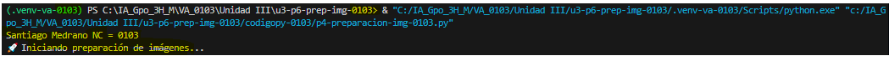
## 2. Procesar imagenes de saxofon
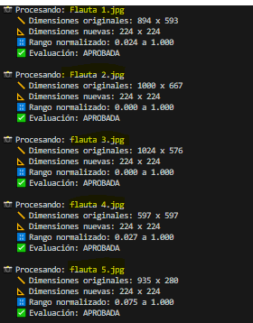
## 3. procesor imagenes de flauta
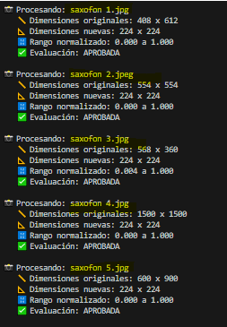
## Imagenes procesadas
### resumen
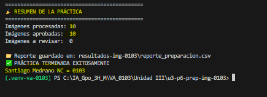
### Saxofon
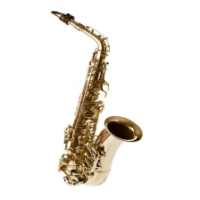
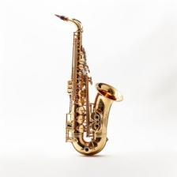
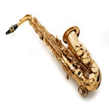
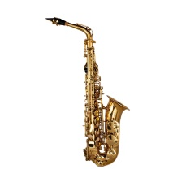
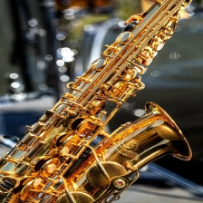
### FLauta
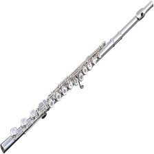
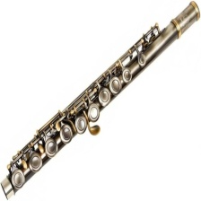
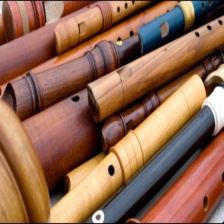
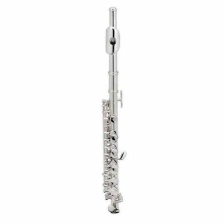
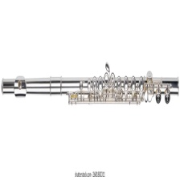